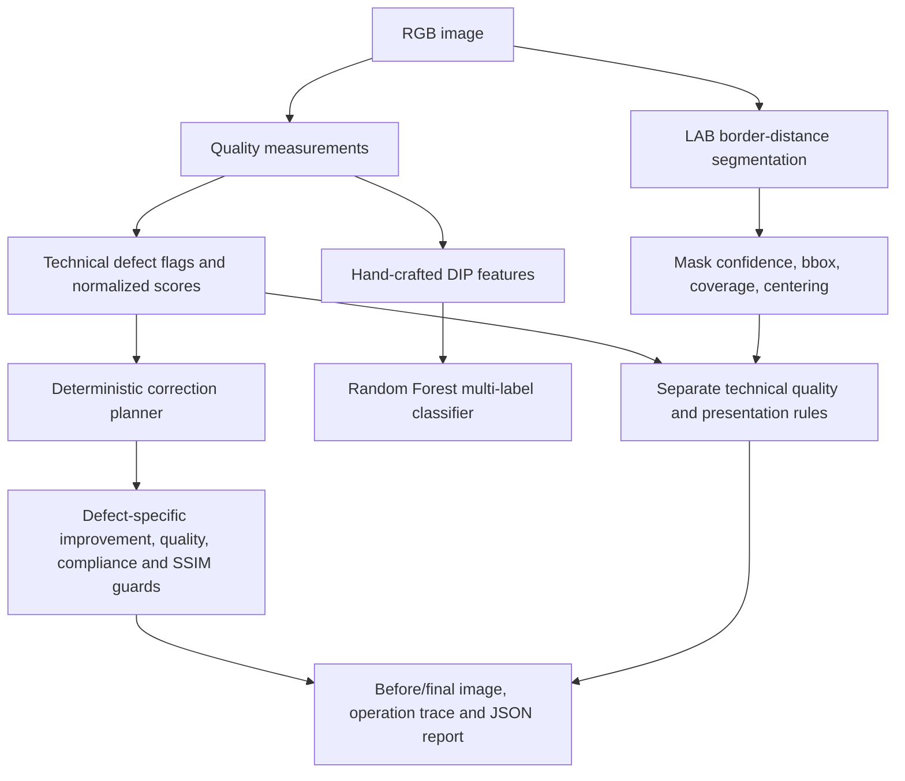

# VisionGuard — HSR-AIML-056

## Scope

VisionGuard is a local, CPU-first product-image quality inspector with classical digital image processing, illustrative presentation rules, a small feature-based Random Forest, and an explainable correction planner. The original project proposal considered cloud, VLM, LLM-agent, generative inpainting and larger model paths. Those are future extensions, not part of this tested repository. The project keeps its core goal: measure product-image quality, expose intermediate processing, compare detection approaches, and avoid silent or unsafe corrections.

## Implemented pipeline

## Quality and defect analysis

`dip/quality.py` reports Laplacian variance, Tenengrad energy, mean/median brightness, shadow/highlight and near-clipping fractions, 4x4 local brightness spread, RMS contrast, flat-region noise, and resolution. Noise is estimated from high-pass residuals of 3x3 and 5x5 median-filtered images on the low-gradient portion of a lightly smoothed guide image. The reported noise value is the median of both scale estimates; confidence incorporates flat-region availability and scale agreement. Noise thresholds are independent of brightness. `QualityThresholds` exposes measurements, weights and cutoffs for validation-set tuning.

Quality component scores are normalized and saturate within bounded ranges. Contrast is penalized both below and above its configured interval; extreme Laplacian response cannot keep gaining score. When exposure has a strong defect flag, the contrast weight is reduced to limit correlated penalties. Final weighted score, component values and effective weights are returned for inspection.

## Segmentation and presentation checks

`dip/segmentation.py` estimates border colour in LAB, thresholds its distance with Otsu in both polarities, applies gentle closing and small-component cleanup, and evaluates the resulting product candidates. Components that touch borders, occupy implausible area, or leave substantial disconnected residue receive lower confidence. The selected mask reports its bounding box, normalized centroid, coverage, method, confidence, warnings and fallback status. GrabCut refinement is attempted only for a sufficiently confident seed mask.

`dip/compliance.py` separates technical quality from configurable marketplace-style presentation checks. Resolution, centering, foreground coverage, border uniformity, optional white background, clipping, and segmentation confidence are reported individually. The default white-background and sizing values are illustrative only and are not official marketplace requirements. A low-confidence segmentation is explicitly shown as a failed/review check, not silently accepted as a valid measurement.

## Correction planner

`agent/planner.py` applies bilateral denoising before tonal adjustments, then considers gamma correction, white balance and CLAHE only when the corresponding measured defect is present. Blur is diagnosed but not automatically sharpened because sharpening cannot recreate lost detail. Each attempted operation records before/after quality, the defect-specific target measurement, defect flags, similarity to the original, guard results and an explanation. It is accepted only when its target metric improves, the overall score rises by the configured minimum, no new quality defect appears, SSIM to the original exceeds the guard, and previously passing presentation compliance remains passing. Rejected candidate arrays are discarded; the input and accepted working image remain unchanged.

## Data, model and evaluation

`data/generate_dataset.py` creates deterministic PIL product-like shapes plus clean controls and single-defect variants (blur, noise, exposure, colour cast and contrast). Source groups stay within train, validation or test splits; the manifest records each clean reference and generated label. `models/train.py` compares deterministic DIP rules with a multi-output Random Forest trained on nine classical image features. `eval/evaluate.py` writes per-defect precision/recall/F1 and confusion matrices, false-positive and false-negative rates, correction counts, clean-control modification counts, quality changes, and aligned clean-reference PSNR/SSIM. Clean unchanged controls are excluded from restoration averages. No segmentation IoU/Dice is reported because no ground-truth masks exist.

All result claims must cite generated artifacts under `outputs/`. The default dataset has only 40 simple synthetic sources; numbers are for reproducibility and demonstration, not real catalog-image performance estimates. The noisy watch sample described in the improvement request was not found in this repository, so regression tests use deterministic synthetic watch-like images and corruption instead.

## Runtime

Run from the repository root with Python 3.11 and `pip install -r requirements.txt`. Then run `python -m data.generate_dataset`, `python -m models.train`, `python -m eval.evaluate`, `python -m scripts.run_demo`, `python -m pytest -q`, and `streamlit run app.py`. Generated data and output artifacts are ignored by Git.
