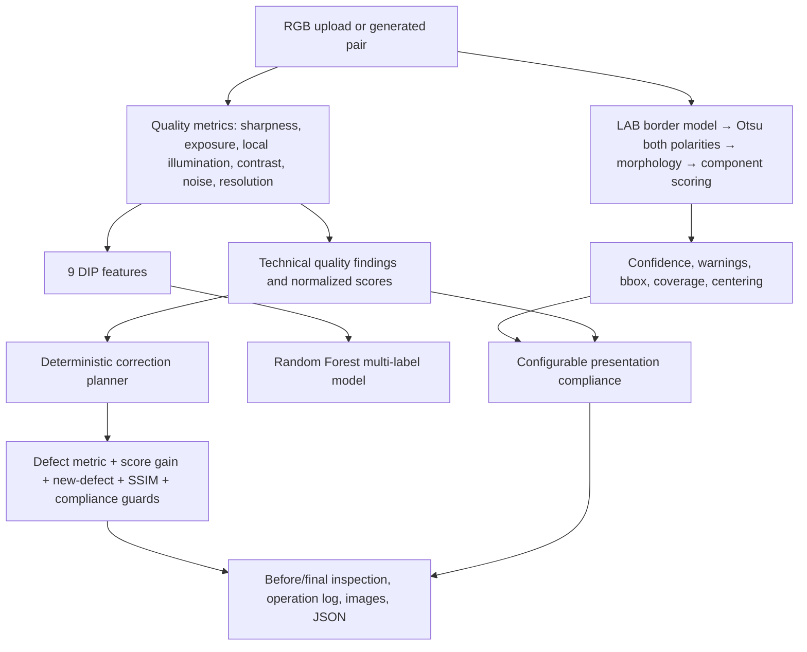

# VisionGuard implemented architecture

This document describes the current local MVP. It supersedes the older aspirational cloud/VLM/LLM components in the original proposal; those components are not implemented or required to run the project.

## Pipeline modules

- `dip/quality.py`: RGB/BGR-safe grayscale conversion; Laplacian variance and Tenengrad; mean and median brightness; shadow, highlight, near-clipping and 4x4 local brightness-distribution measures; RMS contrast; resolution; flat-region noise from multi-scale median residual MAD. The noise estimate includes confidence, flat-pixel fraction and individual scale estimates. Thresholds and score weights are configurable in `QualityThresholds`. Noise flags do not depend on exposure. The exposure score includes the midtone evidence used by its flag; a color-balance component supports measured cast correction. Normalized scores plateau in useful ranges; high contrast and extreme sharpness cannot earn unbounded score increases. Contrast contribution is downweighted when a serious exposure flag is present.
- `dip/enhancement.py`: LAB luminance CLAHE, bounded gamma LUT, median/bilateral/NLM denoising, unsharp mask and border-based robust white balance. Generic operations are opt-in; the planner only selects applicable operations.
- `dip/segmentation.py`: LAB distance to a robust border estimate, Otsu thresholds in both polarities, gentle closing and small-speck cleanup, connected-component plausibility scoring, optional confidence-gated GrabCut, bbox, centroid, coverage, confidence, warnings and empty fallback. A return mask is not treated as trustworthy without a confidence score.
- `dip/compliance.py`: separates technical image-quality diagnosis from configurable illustrative presentation checks. Resolution, centering, coverage, background uniformity, optional whiteness, clipping, and segmentation confidence are individually explained. The disclaimer is included in every report.
- `models/train.py`: multi-output Random Forest over nine hand-crafted DIP features and a deterministic threshold baseline. Source groups remain in one of train, validation and test.
- `agent/planner.py`: noise-first bilateral denoising; then exposure, cast or low-contrast corrections only when diagnosed. Blur is diagnosed, not sharpened automatically. Every attempted fix records target metrics, before/after score, changed defects, SSIM and each guard result. Accepted corrections must improve their target metric, pass a minimum quality gain, add no new defects, retain similarity, and not regress previously passing presentation compliance. Remaining original defect flags produce a `partially_improved` status. Original input arrays are never modified.
- `eval/evaluate.py`: held-out rule and model metrics, per-label confusion matrices and precision/recall/F1, false-positive and false-negative rates, clean/defective counts, operation acceptance/rejection totals, clean-control modifications, before/after quality, aligned-reference PSNR/SSIM, CSV, JSON and charts.
- `app.py`: one or many uploads, persistent session correction result, original and final scores, quality components, segmentation confidence and warnings, operation log, separated compliance view, guarded CLAHE diagnostic preview, corrected PNG and JSON download.

## Data flow and reproducibility

`data/generate_dataset.py` creates a deterministic set of simple PIL-rendered products with clean controls and single synthetic defects. Source groups stay in one split; the manifest is authoritative. Generation cleans the default generated-data split folders or a marker-owned output folder and refuses non-empty unowned custom outputs. Experimental commands can pass one isolated manifest to training, evaluation, demo and research generation. PSNR and SSIM are emitted only for aligned corrupted images with clean references. There are no segmentation labels, so IoU/Dice are not reported.

## Thresholds and limitations

Defaults are transparent starting points, not values tuned to an official marketplace or broad real-world dataset. Calibrate them against a representative validation set before deployment. Local high-frequency texture can still resemble noise; flat-region selection and multi-scale agreement lower but do not eliminate this risk. Border-distance segmentation can fail on clutter, transparent/reflective products, and products sharing the background colour; low confidence and warnings expose those cases. The correction planner prefers leaving a questionable image unchanged over guessing. The synthetic dataset is small and cannot establish performance on real e-commerce imagery.

## Commands

From the repository root: `python -m data.generate_dataset`, `python -m models.train`, `python -m eval.evaluate`, `python -m scripts.run_demo`, `python -m pytest -q`, then `streamlit run app.py`. See `README.md` for environment setup and output paths.
