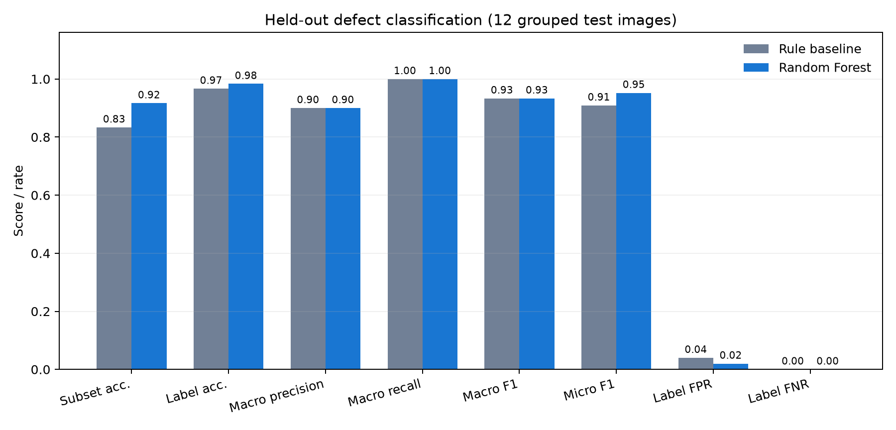
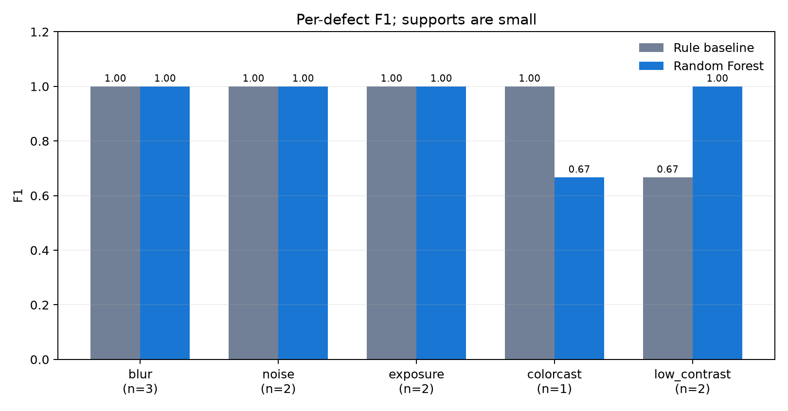
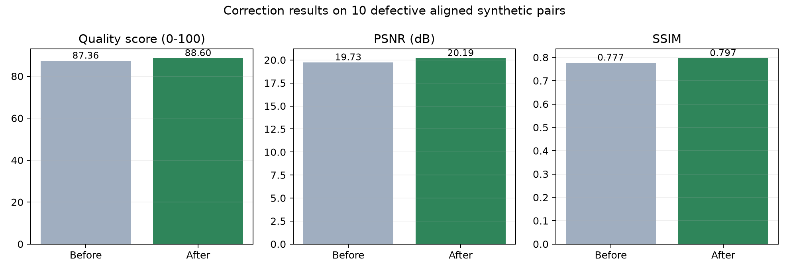
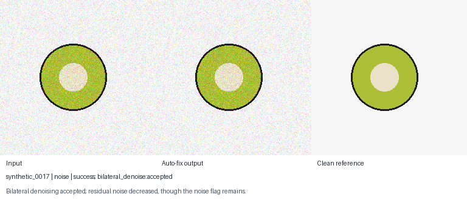
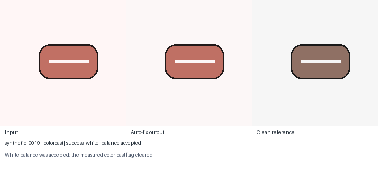
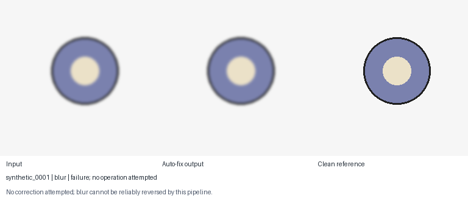

# VisionGuard — Intelligent Image Quality Inspection & Auto-Correction

<p align="center">
  <strong>A Digital Image Processing system for automated e-commerce product image inspection, defect detection, segmentation, and guarded image enhancement.</strong>
</p>

<p align="center">
  <a href="https://github.com/anshulapi/VisionGuard">GitHub Repository</a> •
  <a href="ARCHITECTURE.md">Architecture</a> •
  <a href="ARCHITECTURE_IMPLEMENTED.md">Implementation Details</a>
</p>

---

## Overview

E-commerce product images directly influence product presentation and customer experience. However, images may contain blur, noise, poor exposure, colour distortion, low contrast, inconsistent backgrounds, or unsuitable object positioning.

**VisionGuard** is a Python-based image inspection and correction system that combines classical Digital Image Processing (DIP), computer vision techniques, handcrafted feature analysis, and a guarded correction planner.

The system analyzes image quality, identifies potential defects, evaluates product regions, recommends suitable corrections, and verifies whether an applied operation produces a measurable improvement.

The project is designed as a reproducible, CPU-friendly research prototype using synthetic image experiments.

## System Architecture

```text
              INPUT PRODUCT IMAGE
                       |
                       v
             IMAGE PREPROCESSING
                       |
                       v
          CLASSICAL DIP ANALYSIS
                       |
          +------------+-------------+
          |            |             |
          v            v             v
       Quality      Noise &       Colour /
       Analysis     Sharpness     Exposure
          |            |             |
          +------------+-------------+
                       |
                       v
              IMAGE SEGMENTATION
                       |
              Otsu + Morphology
                 + GrabCut
                       |
                       v
             REGION & COMPLIANCE
                  ANALYSIS
                       |
                       v
             DEFECT CLASSIFICATION
               Rules / Random Forest
                       |
                       v
             CORRECTION PLANNER
                       |
              Candidate Operations
                       |
                       v
              SAFETY VERIFICATION
             Score / SSIM / Defects
                       |
              +--------+--------+
              |                 |
              v                 v
          ACCEPT FIX         REJECT FIX
              |                 |
              +--------+--------+
                       |
                       v
              FINAL INSPECTION
                       |
                       v
            IMAGE + QUALITY REPORT
```

See [ARCHITECTURE.md](ARCHITECTURE.md) and [ARCHITECTURE_IMPLEMENTED.md](ARCHITECTURE_IMPLEMENTED.md) for further details.

## Key Features

| Module | Capabilities |
|---|---|
| Image Quality Analysis | Exposure, contrast, clipping and intensity statistics |
| Sharpness Analysis | Laplacian variance and Tenengrad |
| Noise Estimation | Multi-scale median residual and MAD |
| Image Enhancement | CLAHE, gamma correction and white balancing |
| Denoising | Median, bilateral and Non-Local Means filtering |
| Segmentation | Otsu thresholding, morphology and GrabCut |
| Region Analysis | Connected components, bounding boxes and centroid measurements |
| Defect Classification | DIP rules and Random Forest |
| Correction Planner | Sequential, guarded image correction |
| Evaluation | Accuracy, precision, recall, F1, PSNR and SSIM |
| Interactive Interface | Streamlit-based image inspection and correction |

## Digital Image Processing Techniques

### 1. Image Quality Analysis

- Histogram-derived intensity statistics.
- Mean and median intensity.
- Shadow and highlight clipping analysis.
- RMS contrast.
- Laplacian variance for sharpness estimation.
- Tenengrad gradient-based sharpness measurement.

### 2. Image Enhancement and Restoration

- CLAHE on the luminance channel in LAB colour space.
- Gamma correction using lookup tables.
- Median filtering.
- Bilateral filtering.
- Non-Local Means denoising.
- Border-based colour balancing.

### 3. Segmentation and Region Analysis

- Otsu thresholding with both polarities.
- Morphological opening and closing.
- Connected-component analysis.
- Object bounding-box and centroid extraction.
- GrabCut refinement.
- Confidence-aware component selection.

### 4. Defect Classification

The system evaluates five image defect categories:

- Blur
- Noise
- Exposure
- Colour cast
- Low contrast

A deterministic DIP rule baseline is compared with a multi-output Random Forest trained on nine handcrafted image features.

### 5. Guarded Auto-Correction

The correction planner evaluates candidate enhancement operations and checks whether they improve their intended quality targets.

Corrections are subject to score, defect, similarity and compliance safeguards. Operations can be accepted or rejected based on measured outcomes.

Blur is detected but not automatically restored because lost image detail cannot reliably be recovered through simple filtering.

## Experimental Evaluation

The current experiment uses a controlled synthetic dataset generated with a fixed random seed of **2026**.

### Dataset

| Parameter | Value |
|---|---:|
| Total image groups | 60 |
| Training groups | 42 |
| Validation groups | 6 |
| Test groups | 12 |
| Clean controls | 10 |
| Defective samples | 50 |
| Defect categories | 5 |

Each group contains an input image paired with a clean reference image.

### Classification Results

| Metric | DIP Rule Baseline | Random Forest |
|---|---:|---:|
| Subset Accuracy | 83.3% | 91.7% |
| Label Accuracy | 96.7% | 98.3% |
| Macro Precision | 90.0% | 90.0% |
| Macro Recall | 100% | 100% |
| Macro F1-score | 93.3% | 93.3% |
| Micro F1-score | 90.9% | 95.2% |
| Clean-image False Rejection | 0% | 50% |

### Classification Comparison



### Per-Defect F1-score



### Image Correction Results

| Metric | Before | After |
|---|---:|---:|
| Mean Quality Score | 89.468 | 90.496 |
| Mean PSNR | 19.735 dB | 20.192 dB |
| Mean SSIM | 0.7769 | 0.7965 |



Five correction operations were accepted, three were rejected, and no clean control image was unnecessarily modified in the reported test run.

## Visual Examples

### Noise Analysis



### Colour Cast Correction



### Failure Case — Blur



Additional examples are available in:

- `research/figures/`
- `research/failure_cases/`

## Technology Stack

- **Language:** Python
- **Image Processing:** OpenCV, NumPy, scikit-image
- **Machine Learning:** scikit-learn
- **Interface:** Streamlit
- **Evaluation:** scikit-learn metrics, PSNR and SSIM
- **Testing:** pytest
- **Visualization:** Matplotlib

The implementation does not require paid APIs, GPU inference, or downloaded pretrained models.

## Installation and Execution

### Prerequisites

- Python 3.11 recommended.
- Git.
- pip.

### 1. Clone the repository

```bash
git clone https://github.com/anshulapi/VisionGuard.git
cd VisionGuard
```

### 2. Create a virtual environment

```bash
python -m venv .venv
```

Activate it:

**macOS / Linux**

```bash
source .venv/bin/activate
```

**Windows**

```bash
.venv\Scripts\activate
```

### 3. Install dependencies

```bash
python -m pip install -r requirements.txt
```

### 4. Generate the synthetic dataset

```bash
python -m data.generate_dataset --groups 60 --seed 2026 --out-dir data/generated/research_seed2026
```

### 5. Train the Random Forest model

```bash
python -m models.train --manifest data/generated/research_seed2026/manifest.csv
```

### 6. Evaluate the model

```bash
python -m eval.evaluate --manifest data/generated/research_seed2026/manifest.csv
```

### 7. Run the demonstration pipeline

```bash
python -m scripts.run_demo --manifest data/generated/research_seed2026/manifest.csv
```

### 8. Launch the Streamlit application

```bash
streamlit run app.py
```

### 9. Run tests

```bash
python -m pytest -q
```

### 10. Generate research artifacts

```bash
python research/build_research.py --manifest data/generated/research_seed2026/manifest.csv
```

Use the same manifest for training, evaluation and demo execution to ensure consistent experimental data.

## Repository Structure

```text
VisionGuard/
│
├── agent/
│   └── planner.py
│
├── data/
│   └── generate_dataset.py
│
├── dip/
│   ├── quality.py
│   ├── enhancement.py
│   ├── segmentation.py
│   └── compliance.py
│
├── eval/
│   └── evaluate.py
│
├── models/
│   ├── features.py
│   └── train.py
│
├── research/
│   ├── figures/
│   ├── failure_cases/
│   ├── evaluation_summary.md
│   ├── experiment_manifest.csv
│   ├── experiment_results.csv
│   ├── implementation_status.md
│   └── architecture_diagram.md
│
├── report/
├── scripts/
├── tests/
│
├── app.py
├── requirements.txt
├── README.md
├── ARCHITECTURE.md
└── ARCHITECTURE_IMPLEMENTED.md
```

## Limitations

The current implementation is a research prototype, and its results must be interpreted within the scope of its experiments.

- Experiments use simple synthetic product-like images rather than an independent real-world e-commerce dataset.
- The held-out test set contains only 12 image groups.
- Per-defect test support is between one and three samples.
- The Random Forest is an offline experiment and is not integrated into the Streamlit inspector.
- The correction planner uses deterministic conditions rather than an LLM or autonomous AI model.
- No pretrained vision-language model or external detector is implemented.
- Ground-truth segmentation masks are unavailable; IoU and Dice scores are therefore not reported.
- Real-world marketplace compliance has not been validated.
- Blur detection is implemented, but automatic blur restoration is not.

These limitations define the current scope and motivate future evaluation on real product-image datasets.

## Future Work

- Evaluation on larger real-world e-commerce image datasets.
- Multi-defect detection and classification.
- Ground-truth segmentation annotations and quantitative mask evaluation.
- Threshold calibration and larger validation experiments.
- More comprehensive image enhancement ablation studies.
- Runtime and memory benchmarking.
- Investigation of deep-learning and vision-language model integration.
- Improved restoration for difficult image defects.

## Testing

The reported repository test run completed with:

**15 tests passed.**

Tests cover representative image-processing, pipeline and Streamlit application behavior.

## Research Documentation

- [Architecture](ARCHITECTURE.md)
- [Implemented Architecture](ARCHITECTURE_IMPLEMENTED.md)
- [Project Report](report/PROJECT_REPORT.md)
- [Presentation Outline](report/PRESENTATION_OUTLINE.md)
- [Experimental Summary](research/evaluation_summary.md)
- [Implementation Status](research/implementation_status.md)

## Author

**Anshul Chandra**

B.Tech — Computer Science and Engineering

Project: Digital Image Processing

GitHub: [@anshulapi](https://github.com/anshulapi)

---

<p align="center">
  <strong>VisionGuard — Inspect. Diagnose. Correct. Verify.</strong>
</p>