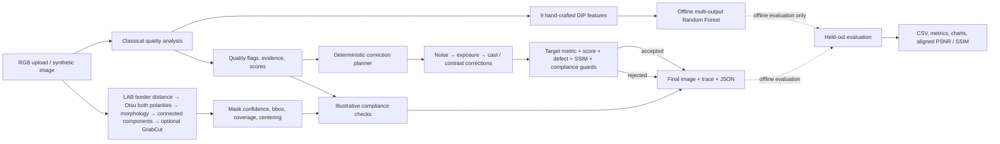

# Audited architecture diagram

The Random Forest is currently not connected to the interactive app or correction planner; the dashed path indicates an offline experiment. Segmentation output is heuristic because the dataset has no pixel-level ground truth masks.
